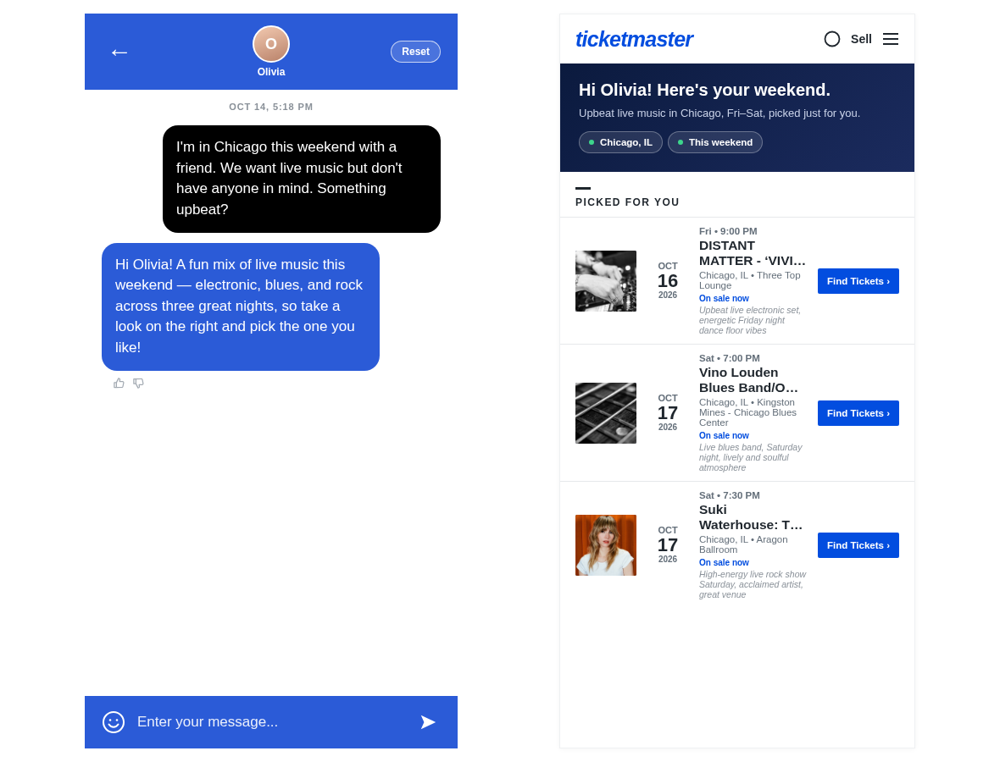
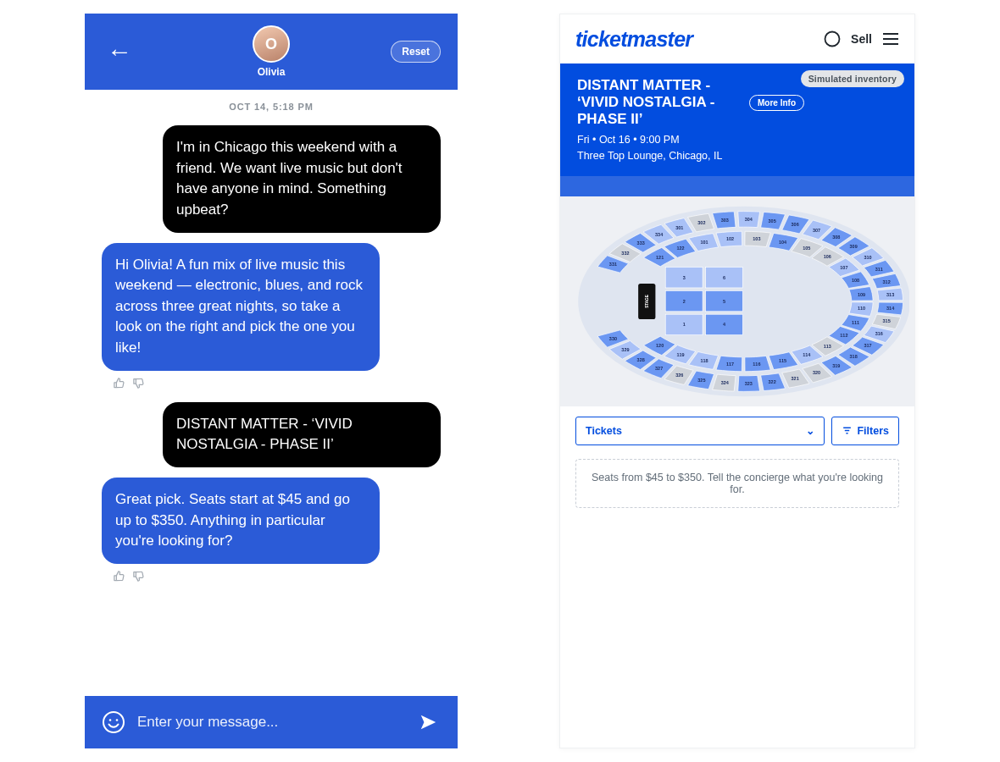
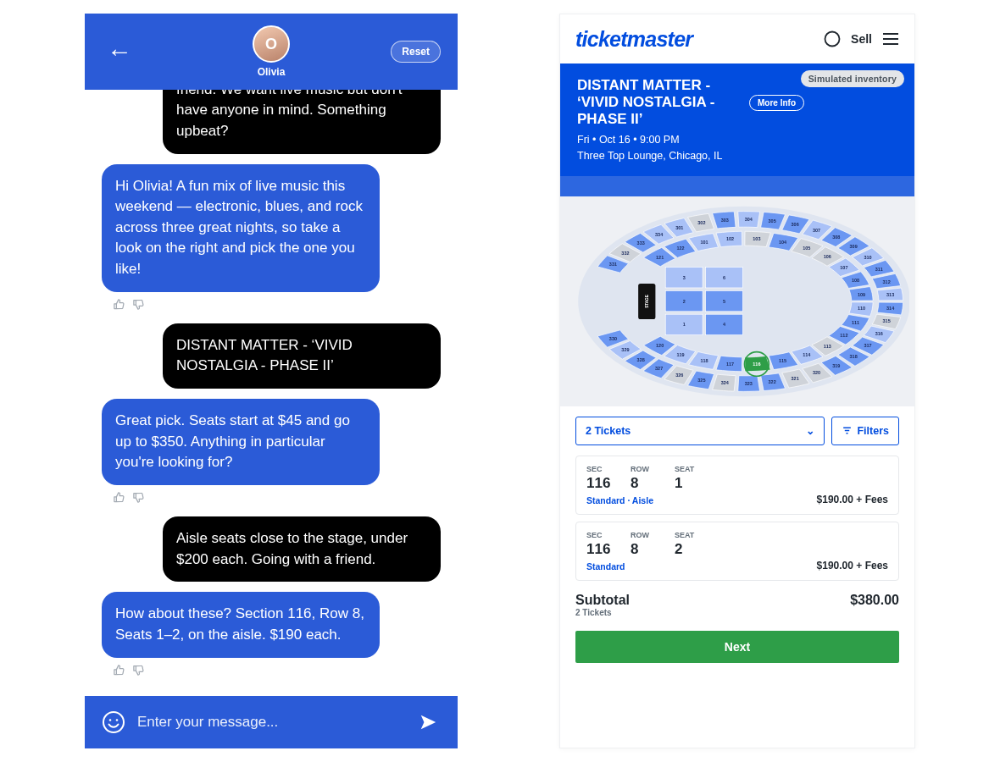
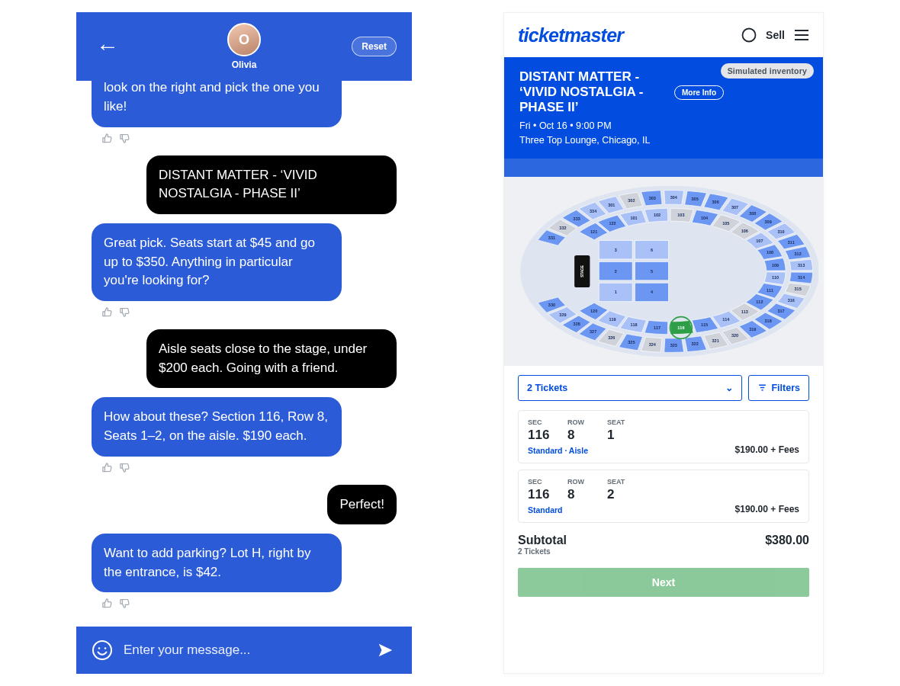
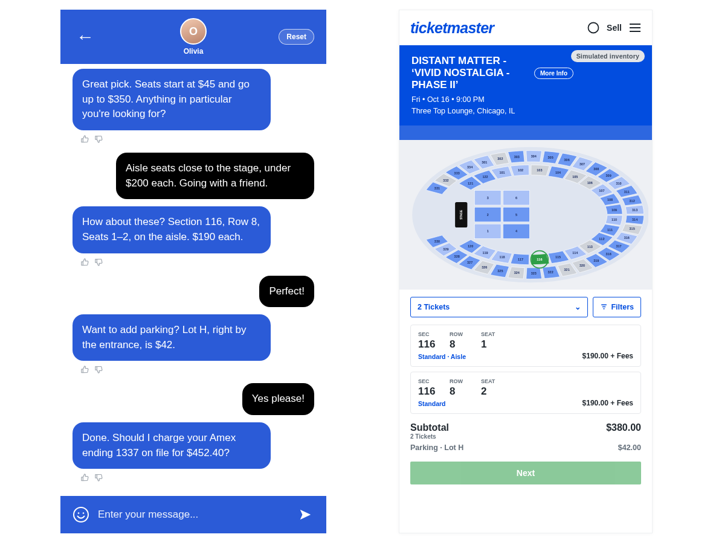
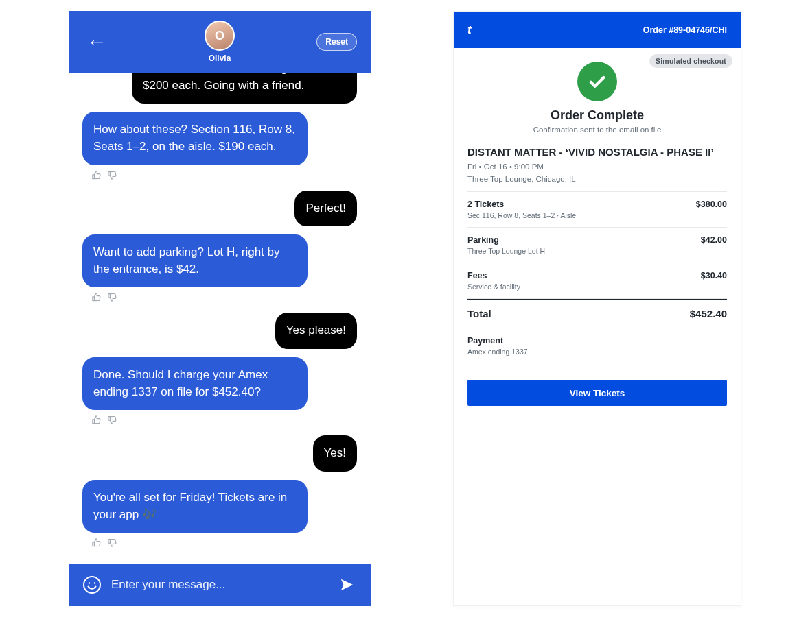

# tm-concierge

A prototype of a conversational concierge for Ticketmaster.com. A fan who doesn't have a specific event in mind describes what they want in plain language, and the concierge takes them from discovery to a completed (simulated) order. The interface is a hybrid: chat on the left, and a Ticketmaster-styled visual pane on the right that updates as the conversation moves along.

Reference mockups: [`docs/mockups/`](docs/mockups).

## Setup

1. Install Node 20+.
2. `git clone https://github.com/arirbrown/tm-concierge && cd tm-concierge`
3. `cp .env.example .env`, then fill in `TICKETMASTER_API_KEY` and `ANTHROPIC_API_KEY`. (If your Anthropic key isn't scoped to a workspace, also set `ANTHROPIC_WORKSPACE_ID`.) `.env` is gitignored. Exported environment variables work too.
4. `npm install && npm start`
5. Open http://localhost:3000 (add `?name=Sam` to change the fan's name; the default is Olivia). Run `npm test` for the intent-parsing unit tests.

## Architecture

- `server/index.js`: Express app. Serves `public/index.html` and exposes `POST /chat`, `/state`, `/reset` and `/feedback`.
- Session state is held in an in-memory `Map`, keyed by an `sid` cookie. Reset replaces the session. A server restart clears all sessions.
- `server/conversation.js`: a small state machine (`discovery → awaiting_city → results → seats → proposed → parking → charge → done`). Each stage reads the turn with one Claude call and replies from fixed templates.
- `server/prompts.js`: every LLM prompt. Each one asks `claude-sonnet-4-6` (via `@anthropic-ai/sdk`) for JSON only, and `server/llm.js` parses the result.
- `server/intent.js`: intent parsing. Claude extracts the fields; deterministic code resolves "this weekend", "today" and "tomorrow", validates the result, and falls back to a regex for budgets.
- `server/ticketmaster.js`: Discovery API client. Converts the local-day window to UTC using the city's timezone, keeps only `onsale` events, widens to a 50-mile radius when there are fewer than 5 results, then dedupes and builds the event cards.
- Ranking: Claude sees one line per real event and returns the top 3 by id. Ids that aren't in the API response are dropped, so the bot can't invent an event.
- `server/seats.js`: generates the simulated arena (floor 1–6, 101–122, 301–334) deterministically per event, and picks the section/row/seats closest to the stage that fit the budget.
- `public/index.html`: vanilla JS/CSS, no build step. The server returns `{ replies, view, stage }` on every turn, and the right pane re-renders from `view`.

## What is real vs simulated

**Real**
- The event search in Flow 1: live Ticketmaster Discovery API results (`events.json`) for the extracted city, date window and segment.
- Event names, images, dates and times, venues and "More Info" links all come from that response.
- The "On sale · from $X" tag and the price range quoted in Flow 2 use `priceRanges[0]` when the API provides a usable range.
- Intent extraction, ranking and turn interpretation are live Claude calls.

**Simulated** (labeled in the UI with "Simulated inventory" / "Simulated checkout" badges)
- The seat map, section availability, section prices, rows and seat numbers. These are generated deterministically from the event id. The arena layout is the same for every venue, including clubs and theatres.
- The price range when the API has no usable `priceRanges` (missing, zero, or min = max): $45–$350.
- Parking (Lot H, $42), the card on file (Amex ending 1337), fees (8% of tickets), the order number, and "Tickets are in your app". No payment is taken and no tickets are issued.

## Demo script

Run against today's real Chicago events. The results change daily.

1. "I'm in Chicago this weekend with a friend. We want live music but don't have anyone in mind. Something upbeat?"
2. Pick the first result by name.
3. "Aisle seats close to the stage, under $200 each. Going with a friend."
4. "Perfect!"
5. "Yes please!" (parking)
6. "Yes!" (charge)

### Screenshots (live run, real Claude + real Discovery API)

**Step 1: discovery with real Ticketmaster events**

**Step 2: pick the first result, the seat map opens**

**Step 3: aisle seats near the stage under $200**

**Step 4: accept seats, parking offer**

**Step 5: add parking, charge prompt**

**Step 6: order complete**

